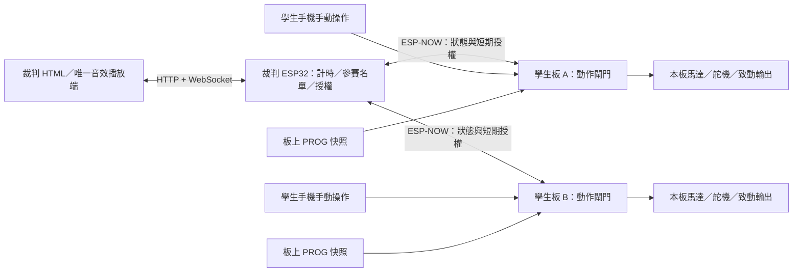

# ESP-NOW 相撲比賽控制系統 SDD

> 日期：2026-11-03；版本：0.3；狀態：第一版軟體已實作；音檔轉散布修正，AUTO 恢復規則已確認；尚未燒錄與實體驗收。
> §1–§11 保留原設計基線與 P0 審查紀錄；**實際入口、封包與落地差異以 §12 為準**。
> 使用者後續已要求開始實作直到完成。本輪包含韌體、裁判／學生頁、音效播放介面、配對工具與離線檢查；原音檔已從目前版本移除，不隨 repo 發布；未執行實體燒錄。

## 1. 需求與範圍

裁判使用一塊獨立主控板及其 HTML 網頁，透過 ESP-NOW 授權本場學生車輛。學生板保留自己的手動控制及自動程式，但兩者均受裁判授權限制。

| ID | 已確認需求 | 設計位置 | 驗收案例 |
|---|---|---|---|
| R01 | 以 MAC address 登記不同學生控制板，顯示隊伍 | §3、§7 | T01 |
| R02 | 主控板提供 HTML 裁判頁，顯示參賽隊伍、時間及模式 | §7 | T02 |
| R03 | 周遭多台車中，只控制選入本場的車 | §3、§6 | T03 |
| R04 | 本場共用計時，一起開放／收回動作權限 | §4、§6 | T04、T05 |
| R05 | 手動、自動、混合三種比賽模式 | §4、§5 | T06 |
| R06 | 手動與自動各預設 30 秒，可調整 | §4 | T07 |
| R07 | 混合可先手動或先自動；兩階段間暫停後自動切換 | §4 | T08 |
| R08 | 無有效授權時，手動指令與自動程式均不能驅動車輛 | §5 | T09、T10 |
| R09 | 裁判可暫停、繼續、結束或停止本場車輛 | §4、§7 | T11 |
| R10 | 使用熟悉的 FRC 原版音效，隨階段播放 | §8 | T12 |
| R11 | 主控板持有計時；關閉網頁不改變比賽流程 | §4、§7 | T13 |
| R12 | 授權逾時停止、狀態回覆不能假報已停止 | §5、§6 | T14、T15 |

「混合」指同一場的車輛同步經過手動／自動兩個階段，**不是一台手動對另一台自動**。同時開始是一起取得權限；手動車仍須收到新的操控指令才動作。

不在第一版範圍：勝負判定、計分與賽程樹、跨場地廣域停止、由裁判傳送連續馬達指令、無線更新程式、修改 motorControl 或 i2cESP32。一般教學模式維持原有使用方式。

### 1.1 設計提案與尚待決定事項

以下保留第一版選擇及確認狀態；AUTO 恢復規則已由使用者定案，其餘未確認項目仍依表中驗收方式處理。

| 項目 | 第一版提案 | 確認／量測方式 |
|---|---|---|
| 裁判板 | 同 repo 新增獨立 ESP32 韌體角色；不初始化馬達及舵機 | 確認實際板型、Flash 容量 |
| 本場車數 | 預設 2 台；先驗證最多 4 台；登記名冊獨立於 radio peer 清單 | 按實際 SDK peer 能力、RAM 與負載測試限制 |
| 階段間暫停 | 預設建議 5 秒，允許 1–60 秒 | HTML 可調；5 秒尚非已確認需求 |
| 動作時間 | 各預設 30 秒，允許 1–600 秒 | 後端整數毫秒檢查；上限可再調 |
| 自動程式來源 | 比賽前從板上已存 PROG 載入並鎖定快照 | 準備時回報摘要與驗證結果 |
| 裁判暫停後恢復 AUTO | 保留剩餘時間，但從鎖定程式的 setup 重新開始 | 2026-11-03 使用者已確認定案，與實作一致；不接續原指令位置 |
| 停止舵機 | 關閉控制脈波，不發出回中命令 | 各車機構實測；不等於切斷電源或機械鎖死 |
| 同步與逾時值 | 見 §6.4，均為工程驗收目標 | 上板測試後才可列為能力 |

## 2. 現況與架構

本設計以當前工作目錄為基準，包含尚未提交的 OLED 等修改，實作時不可覆蓋。現有 I2C SDD 僅參考文件結構；遇到舊 PS4／Wi-Fi 說明，以現行程式及 AGENTS.md 為準。

| 目前檔案／符號 | 對本案的影響 |
|---|---|
| `src/main.cpp::jsonTask` | 約 10 ms 主循環；程式可在 delay／while 內長時間執行 |
| `CommandProcessor::programYield` / `setProgramServiceHook` | 必須在程式內服務授權與停止；不得加入普通 WS 逾時檢查 |
| `controlTickDuringProgram` | 目前先更新角度再執行 hook；比賽閘門必須先於輸出檢查 |
| `stopAllRuntime` | 清馬達模式與控制狀態；目前不涵蓋全部舵機／GPIO |
| `requestProgramStop` / `resetActuators` | 空程式停止會讓舵機回 90°；不可直接重用為比賽停止 |
| `main.cpp::serialTask` | 舊 M/S 指令直接呼叫驅動器，不能只在 JSON router 加閘門 |
| `CommChannel.h` | 表示回應傳輸通道，不代表 MANUAL／AUTO 執行權限 |
| `WebServerHandler.h` | AP_STA、自動連線／重連及 LittleFS 靜態頁面服務 |
| `ProgramStore.h` | 現有 NVS 程式與 autorun；比賽角色要抑制未授權開機執行 |
| `platformio.ini` / `partitions.csv` | 現有 esp32dev 與 esp32dev_i2c；LittleFS 1700 KiB，不預設容得下原音檔 |



### 2.1 角色與模組邊界

| 提案模組 | 職責 |
|---|---|
| `CompetitionTypes` / `CompetitionProtocol` | 純資料、狀態枚舉、封包編解碼，可離線測試 |
| `MatchEngine` | 裁判單一時間源、狀態機、名單凍結、事件序號 |
| `EspNowTransport` | radio callbacks、固定容量佇列、重送、逐一單播 |
| `CompetitionClient` | 學生配對、時鐘映射、租約、故障鎖定與 ACK |
| `ActuationGate` | 最終輸出許可，供各入口及控制環共同使用 |
| `CompetitionWeb` | 裁判 API、狀態推播、登入、瀏覽器控制權 |
| `competition.html` / `competition.js` / `competition_audio.js` | 裁判介面、時間顯示、音效去重 |

新增建置角色提案為 `esp32dev_referee`、`esp32dev_competitor`，共用既有 platform 設定但分開 entrypoint／source filter。前者不建構致動器，後者開機即鎖定。現有 `esp32dev`、`esp32dev_i2c` 不改預設角色。

第一版 competitor 不啟用對上 I2C 控制；編譯時拒絕 `I2C_SLAVE_MODE` 與 competitor 同時啟用。OLED 可保留，但不得占用授權服務時限。未來若學生實際使用 i2cESP32 + motorControl 車體，必須在真正驅動馬達的控制板落實同等閘門；只改 phone_blocky 無法承諾管住外部車體。

## 3. 名冊、配對與控制範圍

資料分三層：

1. `TeamRecord`：`team_id`、隊名、ESP-NOW **STA MAC**、韌體版本、最後看見時間。AP MAC 另欄顯示，不能混用。
2. `PairingRecord`：裁判識別、每車金鑰與配對版本。MAC 是路由及名冊識別，不當作身分驗證密碼。
3. `MatchRoster`：本場選定的 team_id／MAC 清單及雜湊。準備後不可變更，須取消準備才能換人。

配對提案：賽前以 USB 配置隨機金鑰與裁判 MAC；金鑰存在本機受控設定／板上 NVS，不寫 repo、網頁快照或日誌。現場只在「登記」畫面使用低頻 HELLO 發現；未配對車可顯示「待配對」，不能授權。未認證 HELLO 只能表示「被發現」，不能用來證明 READY／健康；選入本場後須建立加密單播並驗證新鮮狀態。

裁判只對凍結名單建立本場授權。名冊可有更多隊伍，但同時建立的 peers 與本場人數須符合韌體實際上限。第一版登記上限提案 64 隊，超過時明確拒絕，避免無界配置。

未參賽的 competitor 保持自身鎖定，不接收本場動作授權。一般教學板維持原狀；主控板不向周遭所有車發送停止或啟動命令。網頁的停止按鈕明確命名「停止本場全部車輛」。

本場結束／取消後，須完成撤權與狀態收斂才釋放 peers。失聯成員保留「停止未確認」紀錄；即使依租約推估已停，也不能改成 ACK 已確認。

## 4. 比賽狀態機與計時

### 4.1 設定與時間軸

```json
{
  "mode": "MIXED",
  "first_mode": "MANUAL",
  "manual_ms": 30000,
  "auto_ms": 30000,
  "gap_ms": 5000,
  "team_ids": ["team-a", "team-b"]
}
```

純手動只用 manual_ms；純自動只用 auto_ms；混合依 first_mode 建立兩階段。未使用欄位不影響時間。範例混合共 65 秒牆鐘時間，其中 60 秒可動作、5 秒停止；不包含裁判額外暫停及啟動準備時間。

每一段使用裁判單調時鐘的起訖時間，不以網頁 setInterval 次數或封包接收次數扣秒。內部建議 64-bit 微秒時鐘，線上使用 uint64 毫秒。`remaining_ms = max(0, phase_end - now)`；顯示秒數向上取整，到 0 即撤權。

### 4.2 狀態轉移

| 狀態 | 可以動作 | 進入／離開條件 |
|---|---|---|
| IDLE | 否 | 編輯隊伍與設定，prepare → PREPARING |
| PREPARING | 否 | 驗證配對、頻道、時鐘、程式；全員 READY → READY；逾時回 IDLE 並報原因 |
| READY | 否 | 名單已鎖定；start → STARTING；cancel → IDLE |
| STARTING | 否，直到共同生效點 | 準備／確認排程；任一失敗 → FAULT；到共同起點 → RUN_MANUAL 或 RUN_AUTO |
| RUN_MANUAL | 有條件 | 只開放手動來源；段末 → GAP 或 FINISHED |
| RUN_AUTO | 有條件 | 只開放鎖定程式；段末 → GAP 或 FINISHED |
| GAP | 否 | 所有致動輸出鎖定；倒數完自動啟動下一段；未就緒 → FAULT |
| PAUSED | 否 | 裁判暫停保存原狀態與剩餘時間；resume 經重新準備後恢復 |
| FINISHED | 否 | 正常結束；reset → IDLE |
| ABORTED | 否 | stop／abort 終止本場；不得 resume；reset → IDLE |
| FAULT | 否 | 通訊、同步、程式或內部故障；處置並 reset → IDLE，重新準備才可開始 |

`pause` 適用於 RUN_MANUAL、RUN_AUTO、GAP；啟動準備中的取消不叫 pause。PAUSED 保留 GAP 的剩餘暫停時間，不得讓背景計時自動開放下一段。`stop` 對所有已建立本場的非 IDLE 狀態有效且冪等。

段落排程在準備時下發，但**只有目前階段的短租約可以授權**。學生不得只因已知下一段時間，就在裁判失聯後自行啟動。GAP 到期仍未滿足下一段準備條件時進 FAULT，不偷偷延長或單車先跑。

同一 tick 的優先順序：abort／故障／提前租約失效 > 階段截止 > 裁判 pause > resume／start > 動作指令。leaseExpiry 等於 phaseEnd 時屬正常階段截止，不誤報失聯 FAULT；只有租約先於 phaseEnd 到期才屬提前失效。截止點與暫停同時發生時先進入該段截止後狀態，再判斷是否仍可暫停；終態不退回運行態。

### 4.3 暫停、恢復與重開機

- 手動恢復：所有舊指令清除；重新授權後要收到新的操控指令，不恢復原 PWM。
- 自動恢復：已確認重跑鎖定快照的 setup／loop，僅給原階段剩餘時間；畫面須清楚提示。不支援接續 delay／巢狀迴圈／副程式的原執行位置。
- 裁判重開機：新的 controller_boot_id，回 IDLE；不從 NVS 恢復 enable 或運行倒數。舊學生租約自行逾時。
- 學生重開機：新 device_boot_id，開機鎖定；即使收到舊本場續租也不解鎖，需要新的準備流程。
- NVS 只保存名冊、配對、預設時間與模式；不保存活躍租約。比賽逐拍狀態保留 RAM，避免高頻寫入。

## 5. 學生板授權與輸出防線

### 5.1 許可條件

```text
allowOutput = competitorRole
           AND pairedControllerAuthenticated
           AND localBootAndSessionMatch
           AND selectedInFrozenRoster
           AND committedPhaseMatches
           AND now >= effectiveStart
           AND now < min(phaseEnd, leaseExpiry)
           AND clockSyncHealthy
           AND NOT faultLatched
           AND sourceMatchesPhase
```

此式限 competitor 角色；教學角色走既有邏輯。拒絕時回傳明確原因（例如 LOCKED、WRONG_PHASE、STALE_COMMAND），不可假回成功。

| 來源 | MANUAL | AUTO | 鎖定／GAP／PAUSED |
|---|---|---|---|
| 指定手動連線的 WS／USB 即時動作 | 允許 | 拒絕 | 拒絕 |
| 鎖定 PROG 快照的直譯器動作 | 拒絕 | 允許 | 拒絕並退出 |
| 新 PROG、AI 送入的 PROG、autorun | 不執行 | 不替換本場快照 | 可在 IDLE 編輯，不能動作 |
| stop／本機停止 | 允許停止 | 允許停止並回報裁判故障 | 允許停止 |
| read／capabilities／遙測 | 允許 | 允許 | 允許 |
| Wi-Fi、角色、PID、zero、檔案等改設定 | 活躍本場拒絕 | 活躍本場拒絕 | 僅 IDLE 且授權管理者可改 |

執行來源與 Comm::Channel 分離；不能因 WS 送進 PROG 就當作手動。手動僅允許一個賽前選定的操作者連線，USB 也不能任意搶占。

雙層防線：入口判斷來源、階段與序號；最終輸出層再次判斷授權／時限。所有控制環的舊目標與角度 HOLD 同樣受閘門限制。比賽模式下將 WS、USB、舊 M/S、程式動作轉交單一致動器擁有任務處理，避免另一核心在撤權後補寫輸出。安全停止佇列優先於普通動作，佇列溢位進 FAULT。

### 5.2 撤權動作

撤權先鎖住輸出，再清除 PWM／RPM／位置目標、積分與 HOLD，並讓執行中的 delay／while／call 退出。清空待執行手動命令，所有命令攜帶當時的 session／phase generation；新一代授權不接納舊命令。

新增競賽專用 `disableCompetitionOutputs(reason)`：

- M1–M4 PWM 歸零並 RELEASE，關閉閉迴路；電子停止不承諾機械立即靜止，滑行距離須量測。
- 舵機取消脈波，不回中；重新啟用只能由新合法命令或新 AUTO setup 指定位置。不可在 competitor 開機呼叫會自動 write(90) 的初始化路徑。
- 本場使用的 PWM／數位致動腳位回到預先登記的安全電位；未知致動腳位配置不得 READY。保留感測器與通訊腳位，不把所有 GPIO 一律拉低。
- 程式快照保留；執行中的容器在安全點退出後才清理，不從 callback 清 active vector。
- 禁止以「空 PROG → resetActuators()」替代上述流程。

目前超音波 pulseIn 最長可能阻塞約 30 ms；不能把 10 ms 主循環說成停止上限。設計要求先量測／限制全部阻塞操作，並在每次硬體寫入前及 program service hook 中檢查 deadline。授權檢查先於角度更新，普通 WS timeout 不加入 programYield。

手動指令需帶本場 token、phase generation、遞增 command_seq，經學生板給予的短期控制上下文驗證。學生板發出的 control_context 綁定操作者連線、generation 與本機 expires_at（最多 250 ms），指令僅引用此 token，不能自行延長期限。斷線、換段、暫停均撤銷 token；逾期封包即使序號較大也拒絕。操作者需取得新 context 並傳送當前操作，不補送積壓指令。

未更新協定的 joy／USB 工具在 competitor 模式不能驅動；不得為相容而省略閘門。手動動作最晚隨 context 到期停止，無新指令即停本車並回報 idle，這本身不使全場 FAULT（學生可以不操作）；操作者連線中斷則回報故障並停全場。此時限與裁判租約分開計時。

## 6. ESP-NOW 協定與同步

### 6.1 頻道與無線邊界

ESP-NOW 基線以 ESP-IDF 4.4.7 文件核對；實作仍須確認 PlatformIO 實際安裝版本。單包設計不超過 250 bytes、callbacks 只複製資料入列、以應用層 ACK 確認落地。傳輸成功 callback 不代表動作已執行。[Espressif ESP-NOW 文件](https://docs.espressif.com/projects/esp-idf/en/v4.4.7/esp32/api-reference/network/esp_now.html)

選用 STA 介面 MAC 作雙向 ESP-NOW 地址，開啟 AP_STA 但在競賽角色禁止 STA 連外與自動重連。裁判與學生 SoftAP 固定在同一個場地頻道；裁判手機連裁判 AP，學生手機各連自己的車。準備前才允許變更場地頻道，需所有板確認。比賽中不掃描或自動跳頻。

原因：AP_STA 的 AP／STA 共用 home channel，連外 STA 可能迫使 AP 換頻。[Espressif Wi-Fi 文件](https://docs.espressif.com/projects/esp-idf/en/v4.4.7/esp32/api-guides/wifi.html#home-channel)

控制封包採逐車加密單播；發現廣播不得攜帶可動作授權。peer 上限與加密 peer 上限以實際 SDK 設定及 add_peer 結果檢查，不能把可登記隊數當作可同步控制數。任一 peer 建立失敗，prepare 失敗。

### 6.2 封包契約提案

以顯式 little-endian 編解碼，不直接傳 C struct（避免 padding／版本差異）。第一版固定 header 64 bytes；payload 至多 128 bytes；應用 frame 至多 192 bytes。整數範圍與精確長度先驗證，再交狀態機。

| header 欄位 | bytes | 用途 |
|---|---:|---|
| magic、version、message_type | 2 + 1 + 1 | 協定辨識與拒絕未知版本 |
| payload_len、flags | 2 + 2 | 嚴格長度；未知 flags 拒絕 |
| controller_boot_id | 8 | 裁判開機 epoch |
| match_id | 8 | 每場唯一，取消後也不得重用 |
| device_boot_id | 8 | 單播目的／回覆來源的本次開機識別 |
| state_generation | 4 | 暫停、恢復、換段、終止均遞增 |
| sequence | 4 | 每個方向獨立遞增；重送使用相同值 |
| sender_time_ms | 8 | 發送者單調時鐘，用於新鮮度／同步 |
| effective_at_ms | 8 | 裁判時鐘上的預定生效點，無此語意時為 0 |
| valid_until_ms | 8 | 裁判時鐘的絕對到期點，非接收後重新計 TTL |

header 合計 64 bytes；HELLO 等未入場訊息的 match_id／generation 為 0，不得據此授權。金鑰由 ESP-NOW 配對管理，JSON 與 frame 不輸出金鑰。需針對實際加密傳輸做抓包驗證。

| 訊息 | payload 要點 | 是否可以開放輸出 |
|---|---|---|
| HELLO／STATUS | 身分、能力、啟動 ID、鎖定原因／健康狀態 | 否 |
| SYNC_REQUEST／SYNC_REPLY | request_id 與四時間戳所需資訊 | 否 |
| PREPARE | mode、phase、名單摘要、程式摘要、階段時間 | 否 |
| READY／NACK | 已驗證的 generation、同步誤差、拒絕原因 | 否 |
| COMMIT_PHASE | 已準備的 phase、起訖時間；valid_until_ms = 0 | 單獨不能，只安裝排程 |
| RENEW | 相同 phase 的租約截止、最新狀態版本 | 為已提交 phase 首次給租約或續租，不能創建新 phase |
| DISABLE | PAUSE／GAP／FINISH／ABORT／FAULT 原因 | 只撤權 |
| ACK_APPLIED | ack_sequence、實際狀態、輸出鎖、程式運行狀態、錯誤 | 否 |

每車保存目前 boot／match／generation 及序號窗口。舊 epoch、舊 generation、過期時間、重播序號或非配對裁判命令均不延長授權。同一封包重送可回相同 ACK，但不得重跑 setup、重開時鐘或續租。序號將溢位前結束 session；不允許環回誤認新訊息。

安全 DISABLE 可跨越遺漏的中間 generation，但只接受目前裁判與目前 match、非舊 generation 的命令；終態為該 match 的封鎖記錄，即使後來出現較大序號也不能重新啟動。另場地控制器的命令不適用。

### 6.3 同步啟動、換段與故障

1. 準備全員：清舊輸出、驗證快照、取得新鮮 STATUS，以往返同步交換估計各板與裁判的時間差及不確定度。READY 綁定名單／generation。
2. 全員 READY 後選共同未來生效時間 T0，下發 COMMIT_PHASE。ACK 必須在 guard deadline 前收到；錯誤或缺少回覆就撤銷全場、停止續租。
3. 學生可預先持有提交排程，但不早於 T0 開放；仍須有效短租約、無故障且時鐘誤差合格。截止時間保存在本機，即使漏掉 DISABLE 也不能越過 phase_end。
4. GAP 期間輸出維持鎖定，可做下一階段 PREPARE／COMMIT。未完成不能單靠 GAP 倒數結束解鎖。
5. 任一參賽板失去 ACK／健康狀態，裁判進 FAULT，撤權全場。學生取得首個租約後，一旦租約提前過期即 faultLatched；延遲 RENEW 不可恢復，需新的準備流程。尚未給租約的提交排程始終鎖定，到 T0 仍無租約則 FAULT；正常 phaseEnd 撤權不算故障。

無線封包可能遺失，無法保證任意故障下「全部同一瞬間成功／失敗」。本案以共同時刻、短租約、缺員全場停止降低不一致時間；不得宣稱分散式原子啟動。取消訊息也遺失時，已提交的一台仍可能短暫動作，最多受本機 lease／deadline 限制；此案例必須實測並記錄。

### 6.4 初始工程數值（尚未證實）

| 項目 | 提案值／驗收目標 |
|---|---|
| 每車 RENEW 週期 | 100 ms；送出排程錯開，等待 radio callback 後再送下一筆 |
| 授權有效期 | 最多 300 ms，且不能晚於本階段結束 |
| ACK／健康回報缺失 | 200 ms 內未見新鮮有效回覆，裁判觸發全場 FAULT |
| 啟動準備窗口 | T0 距目前至少 1000 ms；guard 為 T0 前 500 ms |
| 時鐘同步 | 啟動前不確定度 ≤ 10 ms，運行中定期檢查；失格停止 |
| 正常排程共同啟停輸出差 | 目標 ≤ 30 ms；以硬體輸出時間量測；非突發失聯情境 |
| 已收有效停止至輸出關閉 | 目標 ≤ 50 ms，包含最壞感測阻塞 |
| 無續租後輸出關閉 | 最後有效租約發出後目標 ≤ 400 ms，含同步誤差與執行延遲 |

COMMIT 僅安裝排程，不附啟動租約（valid_until_ms = 0）。全員 ACK 且 guard 通過後才發第一個 RENEW，再持續更新使租約跨越 T0；每次仍不得超過發出時間 + 300 ms。guard 失敗時沒有車獲得租約。如此避免「T0 還沒到，初始租約已先過期鎖故障」的矛盾；guard 通過後才發生的網路分裂仍有上述不可原子化限制。

STATUS 在準備／GAP／PAUSED 仍定期回報，不以 RENEW 才有回報；200 ms 健康門檻以最新應用回覆與期望 generation 判斷。待生效階段排程與目前 GAP 狀態分開保存；新段 generation 不得覆寫 GAP 鎖定，直到共同生效點才原子切換本機狀態。

時鐘映射採 NTP 類四時間戳估計與低 RTT 樣本，保存誤差上限及樣本年齡。接收者使用映射後的裁判時間加上誤差裕量，保守提早截止；不讓校時回撥延長既有租約。時間跳變、漂移超標、樣本過期均鎖定。需在 P1 定出樣本有效期與漂移預算，通過 T04 才能發布同步數字。

## 7. 裁判 HTML 與 API

### 7.1 操作流程

隊伍登記／配對 → 勾選本場名單 → 選三種模式與時間 → 準備並顯示每車檢查結果 → 音效試播 → 開始 → 自動倒數／換段 → 結束。

頁面包含：隊伍列表、模式與先後順序、手動／自動／間隔秒數、大字目前階段與剩餘時間、下一階段、連線健康、已授權／撤權中／已鎖定回覆／停止未確認。暫停與停止本場全部車輛常駐，不藏在設定區。

瀏覽器只按快照估算顯示倒數；重連後以主控板為準。網頁斷線顯示資料過期，不偽裝車輛已停止，也不發本地推測的切換命令。參賽車輛是否物理靜止不能由軟體 ACK 證明，ACK 顯示為「輸出已鎖定」。

裁判控制需本機產生的憑證與管理者 session；讀取頁可唯讀。第一版同時只有一個操作者、其他頁只讀，控制權轉移為明確操作，不因重連搶占。憑證不放 URL／repo。寫入 API 檢查 Origin、授權、request_id 與預期狀態版本；學生的操控連線沒有裁判權限。

### 7.2 擬定介面

| 方法／路徑 | 用途 |
|---|---|
| GET `/api/competition/state` | 取得完整快照 |
| GET／PUT `/api/competition/teams` | 讀取／管理名冊；寫入限 IDLE |
| PUT `/api/competition/config` | 更新本場設定；限 IDLE |
| POST `/api/competition/action` | prepare、cancel、start、pause、resume、stop、reset |
| WS `/competition/ws` | 快照與帶 event_id 的狀態事件，不接收學生馬達命令 |

```json
{
  "request_id": "operator-1-42",
  "expected_state_version": 17,
  "match_id": "00000000000000a1",
  "action": "pause"
}
```

64-bit ID／時間在瀏覽器 JSON 以十六進位或十進位字串傳送，避免 JavaScript Number 精度損失；remaining_ms 為受限 Number。命令入列回 202 不等於車輛已套用；狀態事件回報結果。重複 request_id 回原結果，版本衝突回 409。已驗證、match_id 正確的 stop 不受過期 expected_state_version 阻擋，仍不可停止另一場。

快照至少含 controller_boot_id、match_id、state_version、state、phase_index、phase_mode、phase_start/end、server_now、remaining_ms、下一段、每車 applied_generation／lease／last_seen／fault，以及 audio_event_id。

## 8. FRC 原版音效

原版音效仍是使用者偏好，但目前版本不提供錄音，也不以合成音替代並標示為原版。先前納入的 Team 254 WAV 已因未取得本專案轉散布許可而移除；來源雜湊留存於 manifest，實際使用需由操作者確認許可後本機提供，或明確選擇靜音。使用者另已授權改寫 main 歷史移除四個 WAV；不宣稱可撤回快取或他人下載。

| 本系統事件 | 要使用的音效 | 規則 |
|---|---|---|
| 整場開始 | Cavalry Charge | 第一段無論模式，播放一次 |
| 第一段結束，進 GAP | Buzzer | 一次 |
| GAP 後進 MANUAL | 3 Bells | 一次 |
| GAP 後進 AUTO | Cavalry Charge | 一次；這是自訂順序的映射 |
| 正常結束 | Buzzer | 一次 |
| 裁判中止／全場故障 | Foghorn | 一次並停止其他正在播的提示 |
| 裁判 pause／resume | 第一版只顯示狀態 | 不冒充正常模式切換事件；音效可另議 |

FRC 2025 表列開場、AUTO 結束、TELEOP 開始與中止提示；本案沿用音色但不沿用 FRC 時長。官方也將音效視為提示，時間權威在場地計時。[FRC 2025 §5.9](https://firstfrc.blob.core.windows.net/frc2025/Manual/HTML/2025GameManual.htm)

FRC 場地聲音由 Audience Display 電腦輸出；本案對應為裁判瀏覽器輸出。[FIRST FMS 音訊說明](https://wpilib.screenstepslive.com/s/fms/m/audience/l/558887-about-audience-display)

實作要求：

- 原音檔先逐一試聽核對，再記錄來源、版本、SHA-256、格式、時長、大小與適用使用條件；不以檔名推定原版。候選來源：[Team254/audio](https://github.com/Team254/cheesy-arena/tree/main/static/audio)。
- 音檔隨裁判專用 LittleFS 離線提供，不依賴比賽現場網際網路。先量測容量；若超出裁判分割配置，先選更大 Flash 或調整裁判獨立分割表，不壓縮改音色後仍稱原始檔。不得擠掉學生板網頁。
- 一個指定播放端；準備前按「啟用音效／試播」解除瀏覽器自動播放限制並預載。失敗顯示明確原因。[MDN 自動播放限制](https://developer.mozilla.org/en-US/docs/Web/Media/Guides/Autoplay)
- `controller_boot_id + match_id + event_id` 去重；WS 重送不重播，晚加入／重連只接快照不補播歷史號角。
- 根據主控板狀態事件播放，不由本地倒數猜事件；音訊失敗不改比賽授權。關閉播放頁會失去音效，但主控計時仍繼續。
- UI 提供試播、靜音與軟體音量（裝置限制時提示用系統音量）；正式開始前回報 audio_ready，可由裁判明確選擇靜音開始。

## 9. 分階段實作與驗證

每階段循環：讀取本節必要契約 → 完成最小變更 → 執行對應檢查 → 只修失敗與新風險 → 記錄結果。不得在測試通過後無限重跑，也不得自動 commit／push／燒錄。

| 階段 | 工作與預期檔案 | 完成條件 |
|---|---|---|
| P0 本次 | 本 SDD；需求映射、設計檢查、既有離線回歸 | 文件內部一致；假設與上板關卡明列 |
| P1 純邏輯 | CompetitionTypes、Protocol、MatchEngine、假時鐘測試 | 狀態／時間／序號／長度／亂序案例通過；選定同步漂移預算 |
| P2 學生閘門 | main、CommandProcessor、MotorController、ServoController、PWMManager、joy／USB 契約 | 所有路徑無旁路，含開機、舵機、HOLD、GPIO、長迴圈 |
| P3 裁判通訊 | 獨立建置角色、EspNowTransport、CompetitionClient、配對 | 雙板及四板遺失／重啟／同步實測 |
| P4 網頁音效 | competition HTML/JS、Web API、已核對音檔及清單 | 離線頁面、權限、重連、試播與音訊去重 |
| P5 整合驗收 | 新測試、操作說明、硬體量測報告 | 全部需求驗收、既有模式回歸、場地演練 |

P2 若修改直接控制格式，先更新 [prog_json_schema.md](prog_json_schema.md)；保留原角度 ×100、PWM ±100 語意。新增 gate metadata 不得誤改 AI prompt／PROG 子集。需要改提示詞時依 AGENTS.md 同步。

### 9.1 驗收矩陣

| ID | 必測情境 | 通過標準／層級 |
|---|---|---|
| T01 | MAC、AP/STA 地址、同名隊伍、重複 MAC、未知車 | MAC 唯一、隊伍可辨識、未配對不能 READY；離線＋硬體 |
| T02 | 三模式設定、隊伍列表、倒數與非法時間 | UI／後端同樣拒絕負值、0 動作時長、非整數與超界；離線 |
| T03 | A/B 參賽，C 待命，D 教學模式，鄰場另一裁判 | 僅 A/B 受本場操作；C 不啟動；D 與鄰場不改狀態；硬體 |
| T04 | 兩板／四板預定啟動、時鐘漂移、超音波與 WS 負載 | 用 GPIO／邏輯分析儀量啟停差；達 §6.4 目標，記錄分位數及最大值；硬體 |
| T05 | 漏最後停止包、漏 COMMIT／ACK／撤銷、晚到續租 | 本機截止／租約限制有效，不宣稱全員原子啟動；硬體＋故障注入 |
| T06 | 三模式及兩種混合順序 | 目前模式唯一；錯來源被拒；離線＋硬體 |
| T07 | 30 秒預設、自訂值、截止邊界 | 無 off-by-one、不因 UI 暫停或封包重送加時；假時鐘 |
| T08 | GAP 自動換段、GAP 中裁判 pause、缺員 | GAP 全停；裁判暫停期間不自動換段；缺員 FAULT；假時鐘＋硬體 |
| T09 | WS、USB JSON、舊 M/S、AI／Blockly、autorun、I2C build | 無授權不能動；I2C 競賽組合編譯拒絕；單元＋硬體 |
| T10 | PWM／speed／position HOLD、servo、GPIO、長 delay／while／call | 全面撤權；停止不回中；新授權不重播舊命令；單元＋硬體 |
| T11 | pause/resume、同 tick 截止、stop 重送、終態重播 | 時間與轉移符合 §4；AUTO 恢復政策明示；假時鐘 |
| T12 | 四種原音、首次播放限制、雙頁、重連、亂序事件 | 核對來源；指定端一次播放；不補播舊事件；瀏覽器＋聽測 |
| T13 | 裁判頁關閉、背景節流、網路斷線、重新開頁 | 主控流程持續；畫面恢復採主控快照；硬體＋瀏覽器 |
| T14 | 裁判斷電、學生重啟、換頻、佇列滿、時鐘異常 | 撤權並鎖故障，不自動復活；無線接收佇列溢位須重開故障板並重新準備，清場不解除；量測最大停止延遲；硬體 |
| T15 | send success 但未落地／未回 ACK | 顯示撤權中或未確認，不顯示已鎖定；離線＋故障注入 |
| T16 | 舊 boot／match／generation、封包截短／超長、非配對來源 | 不解鎖、不延長租約、不重跑 setup；編解碼單元測試 |
| T17 | 教學版與 I2C 版、既有 OLED、存檔、程式載入 | 原有離線測試與建置通過；舊行為不受競賽角色影響 |
| T18 | 長時間場地運行、實際手機數、重試與音檔載入 | 至少 30 分鐘負載；記錄 heap、丟包、queue、控制 tick 最大間隔；硬體 |

### 9.2 專案既有必跑檢查

```powershell
.venv-check/Scripts/python -m unittest discover -s tests -v
node tests/check_frontend.cjs
node tests/check_realtime.cjs
node tests/check_examples.cjs
node tests/check_hardware_test.cjs
node tests/check_oled.cjs
```

本次僅文件變更，執行以上離線回歸並檢查連結／需求覆蓋；不宣稱已測 ESP-NOW。未來改韌體需編譯現有及新增角色；改 data 須依部署流程 uploadfs，Blockly script 版本依 AGENTS.md 更新。只有實際修改韌體才要求本次 pio 建置。

## 10. LOOP 工作方式與模型成本

此處 LOOP 是有限的開發／審查循環，不是定時任務，也不是讓車輛自動重複比賽。本輪交付 SDD 後停止，後續實作按 P1–P5 分段進行。

| 輪次 | 輸入與輸出 | 停止條件 |
|---|---|---|
| L1 需求建模 | 對話 → R01–R12、架構、狀態／通訊／介面初稿 | 每項需求有設計落點 |
| L2 交叉審查 | 對照實際程式與官方文件 → 缺口清單及局部修正 | 無未標示的安全語意矛盾；假設可追蹤 |
| L3 驗證收斂 | 文件檢查及必跑回歸 → 本次執行紀錄 | 本次新增問題已處理；既有／環境失敗如實列出 |

節省 token：只讀相關符號附近、搜尋結果限制輸出、同一來源讀一次、測試成功只摘要、修正只提供變更段落。不建立多代理重複完整審稿；若未來要求分工，僅傳需求 ID、相關契約與具體驗收案例。

模型選擇建議：SDD 整合與故障推理用 GPT-6.1 Sol（一般先用 Medium）；Luna 適合已定義規則的格式整理與需求表抽取；只有複雜問題未收斂才提高推理投入。這是任務策略，不代表本回合已自動切換模型，也不承諾特定帳號價格。[OpenAI 官方模型說明](https://learn.chatgpt.com/docs/models)

本回合沒有主模型切換工具，不修改全域 Codex 設定、不另啟 API 任務、不宣稱已使用其他模型。沒有使用者指定 token 上限，因此不虛設 token 預算；以範圍、輪次和輸出限制控制成本。

## 11. 審查與執行紀錄

### L1：需求與初稿

- 已將對話需求整理為 R01–R12；先手動／先自動是全場階段順序。
- 區分已確認的 30 秒與建議的 5 秒；實際板型、恢復 AUTO 語意與性能數值列為提案／量測關卡。
- 以現有程式確認 USB 旁路、舵機回中、HOLD、autorun、感測阻塞與 AP_STA 換頻風險。

### L2：交叉審查

- 已納入：非參賽車不受控制、來源與回應通道分離、單一輸出擁有者、未收到 ACK 不假報停止。
- 已納入：延期封包不可由接收時間重算 TTL、重啟識別、終態不復活、取消遺失下的同步限制。
- 已納入：音效原檔核對與容量關卡、網頁不是計時權威、原版音效目前未交付。
- 第二次逐段推演修正：COMMIT 改為只安裝排程，guard 通過後才開始短租約；自然階段截止與提前租約失效分開；手動遲到指令以學生端到期 token 拒絕；GAP 與待生效階段分開保存。

### L3：本次驗證

2026-11-03 執行結果：Python unittest 4 項通過；frontend、realtime、examples、hardware_test、oled 五組 Node 檢查全部通過，其中 examples 驗證 35 支。這些是現有功能回歸，不代表新競賽系統已實作。

文件檢查已通過：12 項需求均對應既有驗收 ID、18 個驗收案例編號唯一、JSON 範例可解析、相對連結存在、程式碼圍欄成對、無行尾空白；header 各欄相加為 64 bytes，最大 frame 192 bytes 不超過選定的 250-byte 基線。既有追蹤檔的 git diff --check 亦通過（僅有原有換行格式提示）。

尚未執行 pio 建置、ESP-NOW 上板量測、原版音效下載／核對；本次僅新增本文件，未修改韌體、data 或既有使用者變更。P0 文件交付完成，P1–P5 尚未開始；§1.1 的產品選擇與硬體關卡仍待後續確認。

## 12. 實作版契約與驗證更新（2026-11-03）

本節記錄 P0 之後、依使用者「開始動手直到完成」授權所完成的第一版。原稿中的 5 秒間隔與 AUTO 重跑 setup 採作第一版預設，已在裁判與學生 UI 明示。這不是上板性能認證。

### 12.1 實際檔案與範圍

| 元件 | 落地位置／行為 |
|---|---|
| 狀態機與學生租約 | `src/competition/Core.h`，無 Arduino 相依，可直接以 host g++ 測試 |
| Wire 編解碼 | `src/competition/Protocol.h`，64-byte header、嚴格固定 payload 長度 |
| 無線／NVS／時鐘基礎 | `src/competition/Runtime.h`，接收 queue 20 筆、callbacks 不操作致動器 |
| HTTP 共用 | `src/competition/WebSupport.h`，每請求獨立、有上限且 null-terminated 的 JSON body |
| 裁判 | `src/referee_main.cpp`，Async HTTP 只入列，loop 持有狀態機；無馬達初始化 |
| 學生 | `src/competitor_main.cpp`，唯一 loop 執行致動器／PROG；program service hook 維持通訊與租約 |
| 底層閘門 | Gate.h + MotorController／ServoController／PWMManager；CommandProcessor 長迴圈退出與競賽停止不回中 |
| 裁判檔案系統 | `referee_data/`；`tools/referee_filesystem.py` 選擇資料來源，沿用 1700 KiB 分割區；repo 不附 WAV |
| 學生頁 | `data/competition_drive.html`／`.js`，按住行駛、換段清舊操作，既有 Blockly 僅儲存 |
| 配對 | `tools/competition_pair.py`，USB 確認角色後建立每車 LMK、隊名、STA MAC 與固定頻道 |

學生競賽板採獨立 entrypoint，因此不需要把所有舊 JSON 動作改寫成跨任務 queue；舊 main／WebServerHandler 根本不編入此角色。USB 只開配對、資訊、GPIO 設定、停止，不開動作控制。I2C 組合以編譯 guard 拒絕。教學與 I2C 原入口維持既有行為。

手動第一版是新 `/drive` WebSocket 的四馬達 duty 與選用兩舵機角度，並非舊 joy／USB 的全部功能。原有 PROG 中 speed／move_to／move_by 等仍可在 AUTO 使用，沿用既有單位與 NVS 調校參數。GPIO 致動輸出只允許 USB 預先登記的 4／15／18／26／32，安全值 LOW；超音波固定 2／33，避免以感測器設定改動馬達腳位。

### 12.2 實際 radio 契約

header 維持 §6.2 的 64 bytes；magic 為 ASCII `SM`、version=1、flags=0。序號每控制器開機單調增加，**跨場次不歸零**；每車回覆序號也跨場次保留，重啟改 boot ID。實際 message_type 為下表數值，所有整數 little-endian：

| 值／訊息 | payload bytes | 內容 |
|---|---:|---|
| 1 Ping | 0 | header.sent 為 t1，用於測時 |
| 2 Pong | 24 | t1、學生接收 t2、送出 t3，各 uint64；裁判於接收取得 t4 |
| 3 Sync | 12 | int64 裁判時間減學生時間、uint32 誤差上限 |
| 4 Prepare | 2 | phase mode（1 手動／2 自動）、本場是否需要 AUTO 快照 |
| 5 Ready | 9 | 保留編解碼；目前 READY 以 Status.prepared 回報 |
| 6 Commit | 8 | uint64 phase_end；header.effective 為 phase_start，until=0，沒有授權 |
| 7 Renew | 0 | header.until 為裁判時鐘的絕對租約截止 |
| 8 Disable | 1 | terminal bool；撤權、終止或取消準備 |
| 9 Status | 15 | prepared／committed／outputs_on／fault 各 1 byte；ack_sequence 4；program_hash 4；mode／locked／synced 各 1 |

第一版使用 Status 同時提供應用層確認與健康回報，沒有另一種 ACK_APPLIED 封包。名單由裁判建立的加密 peer 清單與逐車 match／boot／generation 約束，不另外傳送名單雜湊。程式摘要是 FNV-1a 32-bit，用於操作辨識，**不是密碼學完整性證明**；程式快照仍只從本車 NVS 鎖定。

實作常數：Renew 最短間隔 80 ms；租約 300 ms；應用健康逾時 250 ms；首次啟動準備窗口 1200 ms；guard 500 ms；Sync 樣本最多 3000 ms。同步 Ping 約每車 700 ms；往返扣除學生處理時間後須 ≤18 ms，估算不確定度 ≤10 ms。這些是判斷門檻，不是實際已量測延遲。

換段在 GAP 中準備新 generation，直到共同 start 才能解鎖；只收到 Commit 不會動。取消準備可能早於學生收到 Prepare，因此 Disable 可安裝一個「本場已鎖定」的終態紀錄，讓裁判收到確認，舊 Prepare 不可再啟動。部分無線遺失仍可能造成短暫不同步，§6.3 的限制仍適用。

### 12.3 實際網頁與 USB 介面

- 裁判讀取 `GET /api/competition/state`，前端約每 200 ms 輪詢，並以 performance.now 平滑顯示；主控板仍是時間權威。第一版未增加 `/competition/ws`。
- 裁判寫入統一 `POST /api/competition/action`，JSON 含 `request_id`、`operator`、`expected_version`、`match_id`、`action`。動作含 claim／heartbeat／prepare／start／pause／resume／stop／cancel／reset。prepare 連同 teams、mode、first_mode、manual_ms、auto_ms、gap_ms 提交設定。
- 裁判 API 使用 `X-Competition-Key` 與 Origin 檢查；一個頁面持有操作者識別，保存最近 16 個 request_id 結果供重送／輪詢辨識。stop 忽略過期版本，但必須匹配本場 ID。名冊建立／更新走 USB；第一版未開 `/teams` PUT 或獨立 `/config` PUT。
- 學生 `POST /api/competition/login` 驗證本車密碼，建立 HttpOnly／SameSite=Strict cookie，供同板 Blockly `/api/program` 儲存使用。`/drive` 另以 claim 驗證，綁定單一 WebSocket client；token 只發給該 client。
- `/drive` 每約 100 ms 發新 context，保留最近三個，**各自固定 250 ms 到期**。每次 drive 要有有效 token 與遞增 sequence；heartbeat 不續動作。手動 JSON 詳見 prog_json_schema.md。
- 暫停 GAP 後恢復，增加 1200 ms 的重新準備窗口，再消耗已保存的 GAP 剩餘時間；AUTO 恢復從 setup 重跑，僅使用保存的動作剩餘時間。
- 時間／模式／勾選名單本次不存 NVS，重開機回預設。名冊、配對、頻道、密碼及安全 GPIO 設定持久化。

### 12.4 原音檔與離線驗證結果

四個原始 WAV 曾於提交 `fd2c132` 納入，來源為 Team254/cheesy-arena commit `248d9de497e701223e2cdbc986a19bbfea054c21`，總計 864,792 bytes。**審查修正：未取得此 repo 的轉散布許可，已移除 WAV，並以 .gitignore 排除本機錄音。** manifest 只保留來源與雜湊，不授予任何權利；來源 LICENSE 作歷史留存。無音檔亦可建置，播放失敗會提示本機提供有使用許可的檔案或勾選靜音。經使用者授權，相關歷史已改寫為 `222973a`／`78ef2d1`，四檔不再出現在 main 的可達歷史中；不宣稱快取、舊 SHA 或他人副本已清除。

音檔移除前的實作驗證紀錄：

- 原有 Python unittest 4 項、frontend／realtime／examples（35 支）／hardware_test／oled 五組 Node 全部通過。
- 新增 Node 競賽檢查：音效事件去重、靜音、重連基準、原檔雜湊、未授權操作、換段清操作與過期 context。
- host g++ 直接編譯 Core.h／Protocol.h，檢查三模式及兩種順序、暫停、準備逾時、序號重播、終態、封包截短、30 秒階段不同斷訊時點的故障注入；啟用 UBSan。
- 四角色 PlatformIO 編譯通過；裁判與學生競賽 LittleFS 均可打包，裁判音檔在 1700 KiB 分割區內，未改分割表。

本機瀏覽器連線預覽伺服器逾時，因此尚未完成真瀏覽器視覺／音訊驗證；不以假 DOM 測試替代這項結果。未燒錄板子、未測無線性能、未量測車體停止、未完成 30 分鐘場地測試。詳細上板步驟與待驗項目見 [competition_setup.md](competition_setup.md)。

審查修正後重新驗證：Python 4 項、六組 Node 檢查通過；競賽檢查在 0 個本機 WAV 下驗證缺檔拒絕啟用音效，且仍允許有適當授權的替代 WAV。裁判 `buildfs` 成功，檔案清單不含 WAV。本次未修改韌體；無線溢位鎖定機制維持原設計，補齊重開機操作說明。
